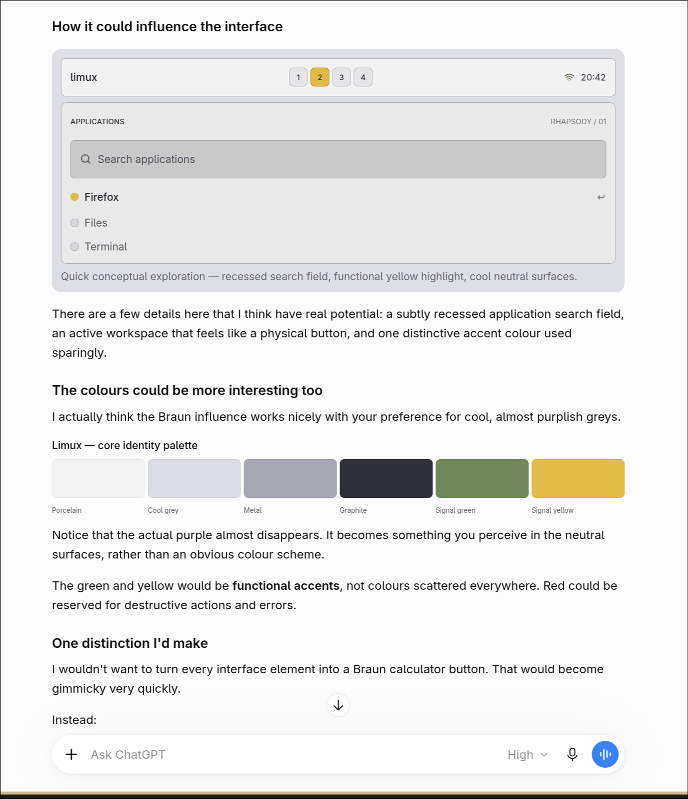

# Limux design language — Rhapsody

This is the canonical reconciled design specification. Established direction takes precedence over later implementation experiments; the newest document or token is not automatically an approved design decision. Read alongside the [vision](vision.md), [architecture](architecture.md), [current implementation tokens](../themes/rhapsody.toml) and [decision log and implementation audit](design-decisions.md).

The [original reference specification](references/original-design-reference.md) is archived evidence, not a competing maintained specification. Its [original visual reference](references/braun-interface-concept.png) is a concept, not a capture of the working desktop or a pixel-perfect layout requirement.

## Identity and influences — established

Limux is the desktop product, interaction model, engineering philosophy and enduring design language. Rhapsody is its first theme. Braun industrial design is fundamental to Limux itself, particularly the ET 66 calculator by Dietrich Lubs and Dieter Rams. Its influence must be visible in precise typography, spacing, alignment and proportions; understated functional appearance; recessed information and input surfaces; subtly raised and depressed controls; carefully defined borders and control geometry. Shallow depth should communicate use and state. The result should feel like a beautifully engineered instrument without exaggerated skeuomorphism. Do not reduce this to “minimal”, “retro” or a lavender recolour, or turn every interface element into a calculator button.

Rhapsody expresses that foundation through complementary historical influences:

- Classic Macintosh Platinum: predominantly light system interfaces, precise chrome and borders, compact controls and information density, subtle depth, clear states and a cohesive operating-system experience.
- Apple Rhapsody: the transition from classic Macintosh personality to a modern developer-oriented system; cool, restrained, slightly technical character.
- NeXTSTEP: functional precision, developer-oriented utility, deliberate hierarchy and strong interface structure.

This is a contemporary reinterpretation, not a literal historical replica. Other themes may express different appearance while retaining Limux's functional precision and engineering principles.

## Material and colour hierarchy

The six initial Rhapsody foundation values remain documented baselines. The subsequent Braun exploration adds material roles and functional signals; it does not constitute a competing palette. Neither approximate screenshot samples nor current experimental tokens silently supersede those baselines.

| Initial Rhapsody role | Foundation value | Relationship to material language |
| --- | --- | --- |
| Canvas | `#DADAE3` | Cool grey system ground, with an almost imperceptible lavender undertone |
| Surface | `#F8F8FA` | Porcelain-like light, clean system and content surfaces |
| Chrome | `#EAE9F0` | Light structural system surfaces, distinguished from content and recessed controls |
| Accent | `#77768F` | Restrained general interface emphasis; not authority to make active workspaces violet |
| Text | `#343442` | Graphite-family readable ink |
| Dark developer surface | `#2F303B` | Graphite-family dark workbench |

Material roles and relative relationships are established; exact reconciled production values remain open:

| Material or signal | Established role | Approximate sample recorded in original specification; proposed comparison only |
| --- | --- | --- |
| Porcelain | Light, clean application and system surfaces | `#F4F3F3` |
| Cool grey | Quiet backgrounds and chrome, barely lavender-tinted | `#DCDCE5` |
| Metal | Secondary and recessed surfaces, borders, control treatments and structural separation | `#A8A8B4` |
| Graphite | Dark surfaces, developer tools and technical depth | `#303039` |
| Signal yellow | Purposeful active/selected states, specifically the original active workspace | `#E3BE47` |
| Signal green | Meaningful positive, connected, successful or functional status where justified | `#728858` |
| Signal red | Destructive actions, errors and urgent states | No agreed hex |

Lavender must be perceived within the neutral greys, not as an obvious purple scheme. Signals are sparse and meaningful, never scattered decoratively. Distinguish general interface emphasis, semantic signals and component-specific selected-state treatments. The yellow active workspace is established; it is not conditional on the legacy token name `accent`. Do not assume every focused border, selected row or menu border must share one accent. Specific mappings beyond the reference require review.

Future token refinement should separate neutral/material roles, general emphasis, selection and signals, including readable foregrounds on each. Token names and exact values are proposals until recorded as approved. Verify contrast for light and dark contexts, and retain non-colour cues for focus, selection and urgency. No foundation value or active-state meaning may be silently changed.

## Concrete component references

Study the complete image, including its rationale and palette, before visual work:

- The system bar is light, restrained and precisely proportioned. Compact workspace controls have defined geometry and shallow physical character. One active workspace is distinctive yellow; inactive controls are neutral. The four illustrated workspaces do not prescribe the configured workspace count or behaviour.
- The light application launcher has a restrained structural border, an understated uppercase “APPLICATIONS” label and quiet “RHAPSODY / 01” metadata. Its mid-grey application-search field is visibly recessed relative to its surrounding surface.
- Compact application rows use clear alignment and hierarchy. The illustrated yellow row indicator conveys meaningful selection; neutral alternatives recede. The green connectivity indicator is functional rather than decorative. Exact status mappings remain to be refined.
- Controls, content and passive information are visibly different. Typography, boundaries and surface depth work together: porcelain foregrounds, cool neutral ground, metal-like recesses and graphite ink. Passive measurements should not become competing badges.

These are references for a component system, not instructions to repeat the screenshot's layout everywhere. The user explicitly rejected a permanent “RHAPSODY / 01” launcher label: omit mockup branding unless it conveys useful information. Avoid floating pills, exaggerated rounding, ornamental bevels, glowing accents, blurred translucent panels and decorative gradients. Subtle raised/depressed treatments and recessed information fields remain part of the design even where an application's renderer requires a simpler approximation.

## Typography, geometry and states

Typography must be precise, compact and readable, with aligned baselines and quieter technical metadata. IBM Plex Sans/Mono versus Inter is unresolved. Inter at 13 logical pixels is a bar experiment, not a final system-wide choice; IBM Plex Mono in the token file is also not evidence of final approval. Verify installed fonts and actual rendering; do not silently rely on fallback.

Delicate edges, compact proportions and restrained corners are established qualitatively. The earlier 1px edge, 4-unit rhythm, 8-unit internal spacing, 12–16-unit group spacing and 3-unit popup radius are exploratory sizing references, not approved universal dimensions. Exact sizes, spacing, radii, weights and component implementations require refinement.

Keep focused, selected, hovered, occupied, empty, inactive, disabled and urgent meanings distinct where exposed by a component. Empty workspaces are not disabled controls. Hover must not erase recognition of the active workspace. Borders define structure and affordances without boxing every passive status item.

## One coordinated light and dark system

Rhapsody is predominantly a light system environment with integrated dark developer tools:

| Light system components | Dark developer components |
| --- | --- |
| Mangobar, Rofi, Mako, GTK/Thunar, system controls and MangoWM window chrome | Foot, terminal-based Codex and appropriate developer-oriented tools |

Both share typography, spacing, border logic, geometry, contrast discipline and semantic accents. Dark developer surfaces belong to the same porcelain-to-graphite hierarchy; do not design an unrelated dark theme. Existing live dark Rofi styling is a preserved operational state, not a revision of this light-system target.

## Architecture, review and approval boundaries

Use one canonical token file per theme and reviewed adapters generating native application styling. Separate functional settings from appearance. See [architecture](architecture.md) for actual ownership, supported behaviour and preview procedures. Current adapter limitations are implementation constraints, not permission to discard the design language. Verify installed application capabilities before promising borders, shadows, recesses or per-module typography.

Maintain one canonical active configuration per component, no stale packages/configurations, duplicate autostarts, orphan scripts or redundant backup clutter. Preserve shared dependencies; verify replacements before safely removing obsolete items. Use Git history for recovery. Preserve MangoWM, Mangobar module logic and startup, shortcuts, Command-key behaviour, workspaces, gestures, Foot interrupts, T2 audio, Touch Bar, keyboard lighting, trackpad, Wi-Fi, display and scaling configuration.

Before each future visual iteration:

1. Read this complete specification and inspect the original image, alongside the required project documents and current tokens.
2. Identify discrepancies and document proposed token, state and component changes. Obtain approval for unresolved final choices or changes to established identity/semantics; do not promote a preview to a permanent decision.
3. Generate supported styling from shared tokens, validate native formats and inspect real screenshots at native scale, including hover, focus, selected and urgent states. Check functional precision, subtle lavender, purposeful signals, depth, accessibility and light/dark cohesion.
4. Preserve behaviour and hardware. Live activation requires explicit authorization and a validated rollback path; a generated preview is not proof of visual approval.

The reconciliation at `f52bb7e` was documentation-only. The subsequently authorized Mangobar candidate implements proposed tokens and styling without permanent activation. The user has since approved candidate 2 as the initial Mangobar baseline and authorized reversible activation. Rofi at `e1f7538` is also approved as the initial baseline, with reversible activation authorized. MangoWM appearance at `fd645da` is approved as the initial baseline without changing its colours, 2px borders, 8px inner / 12px outer gaps or 6px radius. Component approval does not finalize the system-wide typography or other components; evidence and limitations are recorded in the [decision log](design-decisions.md).
